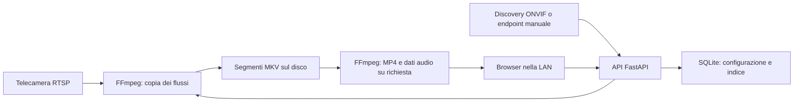

# Architettura di NVR-SR81

L'obiettivo è un registratore locale: telecamere nella LAN, registrazione continua, consultazione dal browser e dischi sotto il controllo dell'utente. Questa prima versione è una base da collaudare con le telecamere reali; non è ancora un sistema sul quale affidare l'unica copia di una registrazione importante.

## Linguaggio e componenti

La scelta è **Python con FastAPI**, con interfaccia HTML/CSS/JavaScript servita dallo stesso processo. Python gestisce configurazione, API, catalogo, supervisione dei processi e analisi audio. La parte video resta a FFmpeg, quindi Python non decodifica ogni fotogramma per registrare. Questo riduce il lavoro da implementare e permette future estensioni di analisi senza obbligare a introdurle adesso. FastAPI fornisce API asincrone, validazione e gestione delle risorse del servizio. [Documentazione FastAPI](https://fastapi.tiangolo.com/)

SQLite conserva configurazione e indice delle registrazioni; i video sono file sul disco, non oggetti nel database. È adatto a un'installazione singola e non richiede un servizio database separato. Il database deve risiedere su un filesystem locale affidabile; più istanze attive sullo stesso archivio richiederebbero un'architettura diversa. [Usi previsti di SQLite](https://sqlite.org/whentouse.html)



## Acquisizione e ONVIF

Il flusso registrato arriva via **RTSP**. ONVIF è usato per richiedere alla telecamera i profili e il relativo indirizzo RTSP; non è un contenitore video alternativo.

L'importazione parte da un endpoint inserito manualmente, ad esempio `http://192.168.1.50/onvif/device_service`, e da credenziali dedicate. Il client usa `GetServices`, con ripiego su `GetCapabilities`, poi `GetProfiles` e `GetStreamUri`. Preferisce Media2, utile anche per i profili H.265, e prova Media1 come alternativa. È possibile fornire direttamente l'endpoint Media. Non scarica WSDL o schemi da Internet. HTTP Digest e WS-Security PasswordDigest sono supportati; l'orologio della telecamera deve essere sufficientemente allineato a quello del server. [WSDL ufficiale Media1](https://github.com/onvif/specs/blob/development/wsdl/ver10/media/wsdl/media.wsdl), [WSDL ufficiale Media2](https://github.com/onvif/specs/blob/development/wsdl/ver20/media/wsdl/media.wsdl), [UsernameToken OASIS](https://docs.oasis-open.org/wss-m/wss/v1.1.1/os/wss-UsernameTokenProfile-v1.1.1-os.html)

Il risultato è una lista di profili con nome, codec dichiarato e URL. Gli indirizzi non specificati `0.0.0.0` o `::` vengono sostituiti con l'host dell'endpoint; le credenziali vengono aggiunte all'URI RTSP quando mancano, codificando i caratteri speciali. Un URI che contiene credenziali è un segreto e va trattato come tale.

La versione 0.2.0 include **discovery IPv4 WS-Discovery ed esplorazione dei profili ONVIF Media1/Media2**, oltre all'endpoint manuale. Un fallback esplicito verifica il servizio ONVIF su sottoreti private fino a /24. I profili mantengono nome/token e metadati originali; i suggerimenti main/sub sono calcolati per sorgente video e non configurano la telecamera. Non è una dichiarazione di piena conformità ONVIF: restano esclusi PTZ, gestione utenti, eventi e modifica dei codec. Alcuni produttori richiedono l'attivazione di ONVIF o un account specifico; rimane disponibile l'inserimento diretto dell'URL RTSP. [Guida discovery](discovery.md)

## Registrazione originale e riproduzione web

FFmpeg registra il video H.264 o H.265 con **copia dei pacchetti**, senza ricodificarlo, e conserva l'audio sorgente se presente e compatibile con il contenitore Matroska. Il formato MKV evita di imporre AAC alle telecamere che forniscono altri codec audio. Un codec non gestito dalla build FFmpeg o dal contenitore richiede un adattamento esplicito e una prova con quel modello.

L'archivio usa file di circa **30 minuti**, con copia dei flussi senza ricodifica. Le chiusure avvengono in corrispondenza dei fotogrammi chiave: la durata reale può superare quella richiesta e dipende dal GOP della telecamera. Il file in corso viene indicizzato dopo la chiusura; lo stato di registrazione viene invece aggiornato quando FFmpeg inizia a scrivere. Un arresto regolare finalizza anche il segmento più corto. [Segmentazione FFmpeg](https://ffmpeg.org/ffmpeg-formats.html#segment_002c-stream_005fsegment_002c-ssegment)

Per il browser si genera una copia **MP4 H.264/AAC su richiesta**. L'originale MKV rimane l'archivio: la conversione per la consultazione richiede CPU, tempo e spazio per la cache. HEVC/H.265 non ha una compatibilità uniforme tra browser, sistemi e hardware; anche H.264 può richiedere conversione per profili o formati pixel particolari. La riproduzione va verificata sui dispositivi client scelti. [Guida codec del browser Mozilla](https://developer.mozilla.org/en-US/docs/Web/Media/Guides/Formats/Video_codecs)

L'anteprima della scheda Registratore rimane una successione di immagini aggiornate. Dalla versione 0.3.0, **Monitor live** offre invece video continuo con audio facoltativo: un processo FFmpeg condiviso per telecamera/modalità emette MP4 frammentato su WebSocket autenticato e il browser lo riproduce con MSE. Il flusso secondario è preferito per il monitor; la registrazione originale resta indipendente. Le conversioni video H.264 sono limitate separatamente quando il client non supporta il codec originale. Non è richiesto un gateway esterno; WebRTC e accelerazione hardware restano possibili estensioni. [Guida monitor live](live.md)

## Ricerca temporale e forma d'onda

Il catalogo conserva i tempi in **UTC** e il browser mostra data e ora nel fuso locale, rendendo più chiari anche i cambi fra ora solare e legale. L'indice usa i tempi dei segmenti rilevati dal server: orologi sincronizzati nella LAN sono necessari per correlare più telecamere, e questa base non promette una sincronizzazione forense al fotogramma.

La forma d'onda sotto il lettore si calcola decodificando solo l'audio e riassumendo i **picchi di ampiezza** in finestre temporali. I dati compatti vengono disegnati e cliccati per spostare il punto di riproduzione. Non serve un modello di intelligenza artificiale. Un picco è un indizio da ascoltare, non il riconoscimento di uno sparo, di una voce o di uno specifico evento. Se non esiste una traccia audio, l'interfaccia lo segnala.

## Dischi e dimensionamento

Il parametro più utile è il **bitrate medio effettivo**, misurato sulle telecamere. Risoluzione e codec da soli non bastano a calcolare lo spazio.

```text
GB al giorno = somma bitrate medi in Mbit/s × 10,8
GB necessari = GB al giorno × giorni di conservazione
```

Il fattore deriva da `1.000.000 bit/s ÷ 8 × 86.400 s = 10,8 GB/giorno`, con GB decimali. Esempio di pianificazione, non misura del software: 4 telecamere a 4 Mbit/s richiedono circa 172,8 GB/giorno, quindi 2.419,2 GB per 14 giorni. Aggiungere audio, contenitori, database, cache di consultazione, variazioni del bitrate e spazio libero operativo. La banda di acquisizione dell'esempio è circa 16 Mbit/s, prima degli altri flussi di rete.

Per l'uso continuo è preferibile un disco dedicato alle registrazioni; un SSD può ospitare sistema, indice e cache. La conservazione automatica elimina le registrazioni più vecchie secondo i limiti impostati. La prima versione usa una radice di archivio: più dischi possono essere presentati dal sistema operativo come un volume, oppure il supporto a più destinazioni dovrà essere aggiunto in seguito. Un backup separato riguarda soprattutto configurazione e spezzoni da conservare oltre la normale rotazione.

## Ubuntu, Debian, Proxmox e Raspberry Pi

Il percorso iniziale è Linux: Ubuntu o Debian su PC, VM oppure container LXC Proxmox. In LXC l'archivio va montato dal nodo con un **bind mount**, verificando proprietario, UID/GID e permessi del processo; i dati del bind mount richiedono una strategia di backup esplicita. L'installazione diretta nel container evita di introdurre anche un secondo livello di containerizzazione. [Documentazione ufficiale Proxmox sui mount point](https://pve.proxmox.com/pve-docs/pve-admin-guide.html#pct_mount_points)

Un Raspberry Pi con sistema **ARM64**, rete cablata e disco USB adeguato è una possibile piattaforma da collaudare. Non viene promesso un numero di canali: incidono bitrate, disco, alimentazione, dissipazione, anteprime contemporanee e conversione per il browser. La registrazione con copia dei flussi pesa molto meno della ricodifica; la conversione H.265 → H.264 è il carico da misurare per primo su hardware piccolo. L'accelerazione hardware non è richiesta dal primo rilascio né configurata automaticamente.

## Funzionamento locale ed evoluzione

Dopo avere installato pacchetti e dipendenze, il servizio e gli elementi dell'interfaccia sono locali: nessun account cloud, CDN o chiamata a un servizio di analisi è necessario. Le richieste di acquisizione e importazione vanno agli indirizzi configurati. Per garantire l'isolamento anche delle telecamere e del sistema operativo, la rete deve bloccare le connessioni verso Internet e usare, se necessario, DNS e sincronizzazione oraria locali.

Il collaudo deve includere riconnessione dopo caduta della rete, riavvio del servizio, esaurimento spazio, conservazione, audio e consultazione simultanea alla registrazione. I test automatici delle API e delle risposte ONVIF simulate non sostituiscono una prova continuativa con hardware reale.

La consultazione include una traccia di movimento senza AI, calcolata per il video archiviato selezionato mediante differenze fra immagini e conservata nella cache locale. Gli sviluppi successivi sono separabili: ulteriori ottimizzazioni live/WebRTC e accelerazione hardware, maschere ed eventi di movimento in diretta; infine un motore AI opzionale in un processo dedicato. Un futuro adattatore YOLO o altro modello dovrebbe consumare il sottoflusso a frequenza ridotta e scrivere metadati nell'indice, lasciando la registrazione continua indipendente dal suo stato. Modello, licenza e hardware si sceglieranno quando ci sarà un requisito concreto.
